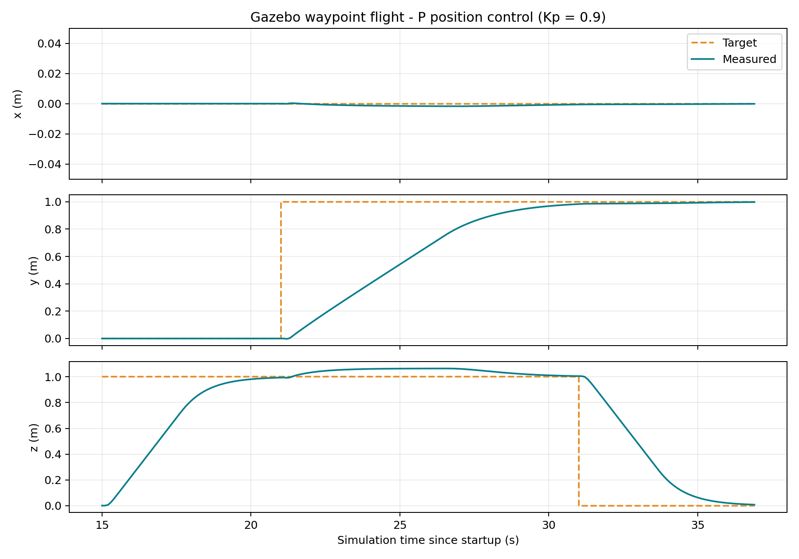
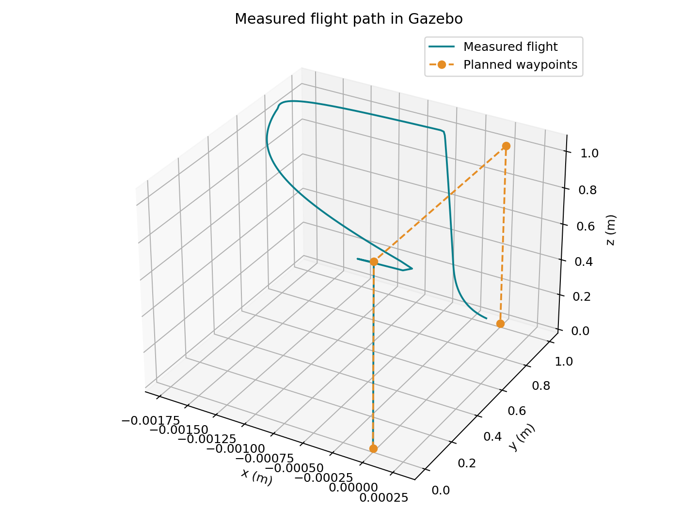

# Validation results

Tested on 2026-10-11 with ROS 2 Humble and Gazebo Harmonic 8.15.0.
The controller uses Kp = 0.9, horizontal limits of 0.25 m/s per axis, and a
vertical limit of 0.30 m/s.

| Run | Reached waypoints | Maximum arrival error | Result |
| --- | ---: | ---: | --- |
| assignment | 3 | 0.0188 m | PASS |
| square | 6 | 0.0194 m | PASS |
| recording | 3 | 0.0188 m | PASS |

Arrival means the 3D position error remained below 0.07 m for 2 seconds.
These are arrival errors, not maximum errors during motion: changing the target
creates a large error until the drone reaches it. The plots show that transient.
There is a small vertical overshoot during horizontal travel; no claim of
perfect tracking is made.

The assignment run follows (0,0,1), (0,1,1), (0,1,0). The square run adds four
horizontal sides at z = 1 m before landing. Each row is a separate live Gazebo
run, with its CSV and JSON under `data/`.

The recorded run has a 15-second initial wait for the capture to start; the
headless tests use 4 seconds. CSV time is simulation time; video time is wall
clock time. The video captures the RViz rendering window while Gazebo runs in
the background.

## Controller checks

`tests/test_controller.py` also checks:

- Positive/negative errors produce commands with the expected signs.
- Large errors are limited to the configured speeds.
- Commands become zero after feedback and target messages stop.
- Control resumes when fresh messages return.

Run it from the built workspace:

```bash
source /opt/ros/humble/setup.bash
source install/local_setup.bash
ROS_DOMAIN_ID=105 ROS_LOCALHOST_ONLY=1 python3 src/capstone_demo/tests/test_controller.py
```

Run the two complete simulation checks:

```bash
python3 src/capstone_demo/scripts/validate_demo.py
```

The graphics diagnostics may include EGL warnings on the tested hybrid-GPU
laptop. The recorded rendering and telemetry were checked. Shutdown logs can
include signal/KeyboardInterrupt messages because the test closes its nodes.




